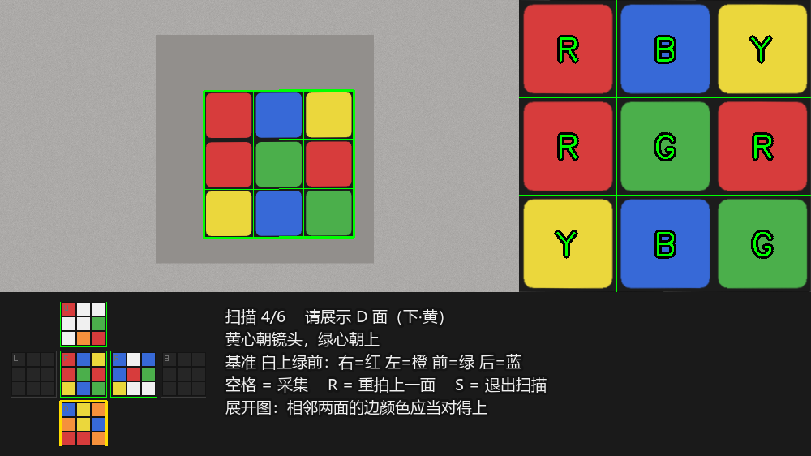
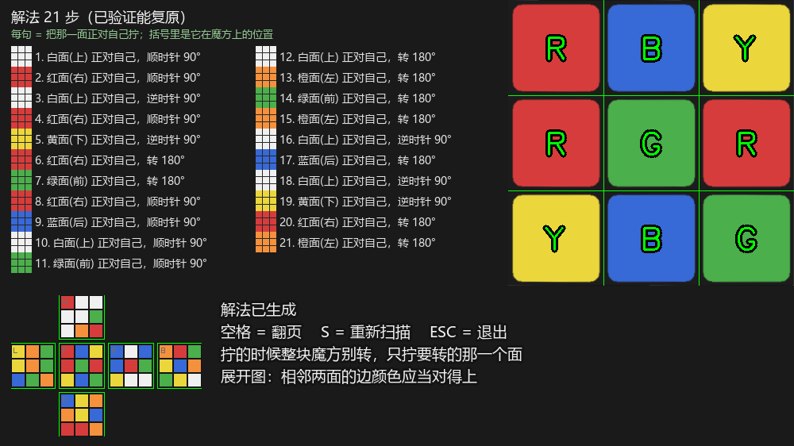

# 魔方识别与求解（CNN + Kociemba）


## 界面

扫描六面（下方是实时展开图）：



识别完成后给出中文解法：



> 截图是**合成画面**（纸板背景 + 程序画的贴纸），用来展示界面布局。

## 这是什么

一个**不训练看不懂、训练完特别准**的魔方视觉求解器：

1. 固定机位 + 聚光灯 + 纯色背景，魔方每次放在画面里同一个位置；
2. 程序按配置里的四个角点，把画面中的这一面**透视压平**成正方形；
3. 切成 3×3，每格取中心一小块喂给一个小 CNN，输出 6 个颜色的打分，取最高分；
4. 六面采完拼成 54 个色块，丢给 Kociemba 两阶段算法求解；
5. 解法翻译成中文文本：**「3. 红面(右) 正对自己，顺时针 90°」**，带分页和自动验证。

整个流程没有任何命令行参数：所有可调的东西都在文件顶部的常量、`config.json` 和「标注训练」窗口里。

## 工作流程

```
摄像头 1280×720
   │  四个角点（config.json，归一化坐标）
   ▼
透视变换 → 450×450 压平
   │  等分 3×3，每格中心 60×60 → 缩放 32×32
   ▼
CNN（2 层卷积 + 2 层全连接）→ 9 格颜色
   │  U → R → F → D → L → B 依次采六面
   ▼
54 个色块 → kociemba.solve() → 解法串
   │
   ▼
中文步骤 + 面向图标 + 展开图，写进 solution.txt
```

## 快速开始

### 1. 装依赖

```bash
pip install opencv-python numpy torch pillow
```

`kociemba/` 里的两阶段求解器是项目自带的纯 Python 实现，已包含预计算的剪枝表，不需要 pip 安装。

### 2. 第一次运行：标注，训练

```bash
python train.py
```

窗口左边是相机画面（可以拖四个角点对准魔方面），右边是压平后的 3×3：

- `w y r o b g` → 给当前格贴标签，然后自动跳到下一格；
- 贴完 9 格回到第 1 格，**转一下魔方换个角度继续贴**，同样的颜色在不同光照/角度下都算一个样本；
- `1`~`9` 手动选格，贴错了就重贴；
- `T` → 开始训练，训练完存成 `cnn.pt`，同时把当前四个角点存进 `config.json`。

一般验证准确率能到 95% 以上。

### 3. 开始识别

```bash
python main.py
```

先把魔方放进绿框，按 `S` 进入六面扫描，按提示依次摆好六面，每面按一次空格。采满六面自动求解，屏幕上出现中文步骤，同时写一份 `solution.txt`。

## 按键

| 窗口 | 按键 | 作用 |
| --- | --- | --- |
| 主窗口 | `S` | 进入 / 退出六面扫描 |
| 主窗口 | `空格` | 扫描中：采集当前面；已出解法：翻页 |
| 主窗口 | `R` | 重拍上一面 |
| 主窗口 | `ESC` | 退出 |
| 标注训练 | `w y r o b g` | 给当前格贴标签并跳下一格 |
| 标注训练 | `1`~`9` | 手动选格 |
| 标注训练 | `T` | 训练并保存 `cnn.pt` |
| 标注训练 | `ESC` | 退出 |

## 扫面朝向

六面的 3×3 行列方向必须和 kociemba 的面序一致，所以每一面都有固定的摆法：

| 顺序 | 面 | 摆法 |
| --- | --- | --- |
| 1 | U 上 | 白心朝镜头，绿心朝下 |
| 2 | R 右 | 红心朝镜头，白心朝上 |
| 3 | F 前 | 绿心朝镜头，白心朝上 |
| 4 | D 下 | 黄心朝镜头，绿心朝上 |
| 5 | L 左 | 橙心朝镜头，白心朝上 |
| 6 | B 后 | 蓝心朝镜头，白心朝上 |


**采集完先看窗口下方的展开图**：相邻两面边上的颜色必须对得上。对不上就是有一面摆反了或采糊了，按 `R` 重拍那一面。

## 为什么用 CNN 判色（CNN 太棒了）

一开始用的是经典做法：HSV 阈值 + LAB 参考色。同一块贴纸，正面拍是红的，稍微偏一点光就掉到橙的区间里；白块在阴影下饱和度低到能骗过白色阈值；红橙两个色相只差十几度，光照一变整个阈值表就得重调一遍。
换成 CNN 之后：

- **不用再调色相区间**。网络看的是整块贴纸的纹理和明暗关系，红就是红；
- **几秒钟标几十张图就能用**。模型只有两层卷积（参数不到 6 万），`cnn.pt` 才 550KB，CPU 上一面 9 格推理不到 1 毫秒；
- **对光照和角度天然宽容**。训练时做了随机翻转、旋转、亮度 0.8~1.2、色偏 ±0.2 的增强，等于免费造了一堆「换个角度/换个灯泡」的样本；
- **换魔方只要重训一次**。不需要重新研究「这块到底是红还是橙」。

## 目录结构

```
.
├── main.py            # 识别 + 扫描 + 求解主流程（相机、CNN 推理、状态机）
├── train.py           # 标注与训练窗口
├── ui.py              # 所有画图：相机视图、压平面板、展开图、解法页、中文文字
├── cnn.pt            # 训练好的权重（你训练出来的那份）
├── config.json        # 画面中魔方面的四个角点（归一化坐标）
├── solution.txt       # 最近一次解法（运行后生成）
├── docs/              # README 用的界面图
└── kociemba/          # 纯 Python 两阶段求解器 + 预计算剪枝表（约 21MB）
```

`ui.py` 里没有任何业务逻辑，`main.py` / `train.py` 里没有任何画图代码 —— 想改界面只动 `ui.py`，想改算法只动 `main.py`。

## 配置文件 config.json

```json
{"quad": [[0.392, 0.311], [0.681, 0.309], [0.681, 0.813], [0.392, 0.815]]}
```

四个点是画面里魔方面四角的**归一化坐标**，顺序是左上 → 右上 → 右下 → 左下。它由 `train.py` 按 `T` 时自动写入；想手调就直接改这四个数，或者在 `train.py` 里拖角点再存一次。因为坐标是归一化的，改摄像头分辨率不会让框错位。

## 许可证

[MIT](LICENSE)

## 致谢

- 两阶段求解算法来自 Herbert Kociemba，本项目内置的是其 Python 移植版；
- 界面排版参考了 [readmine](https://mhucka.github.io/readmine/) 与 [Best-README-Template](https://github.com/othneildrew/Best-README-Template)。
